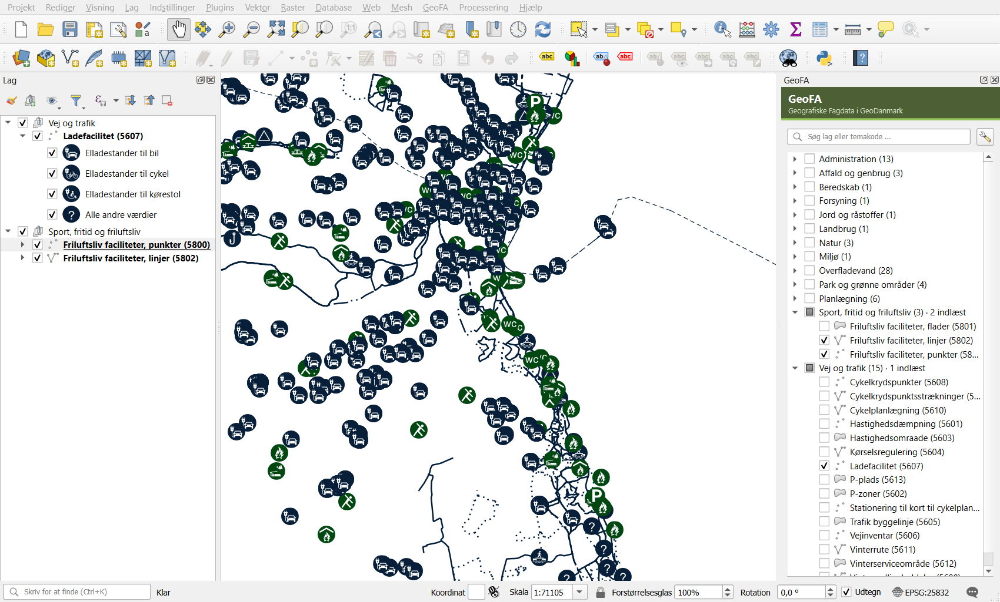
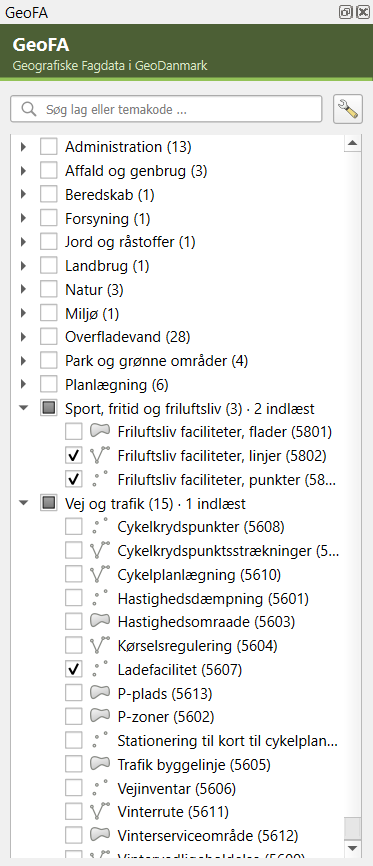
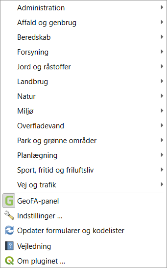
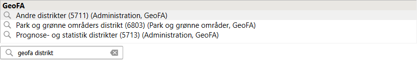
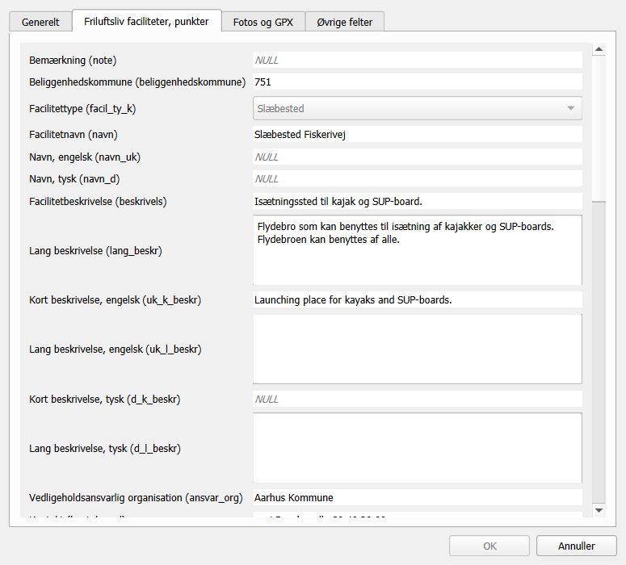
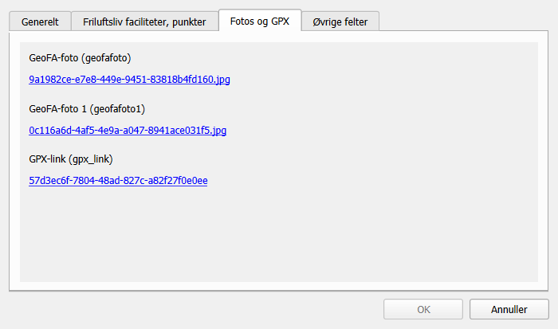
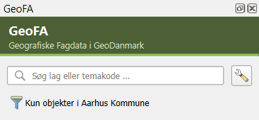
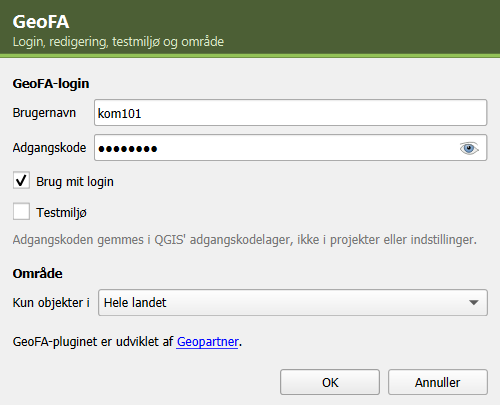
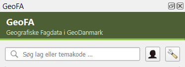
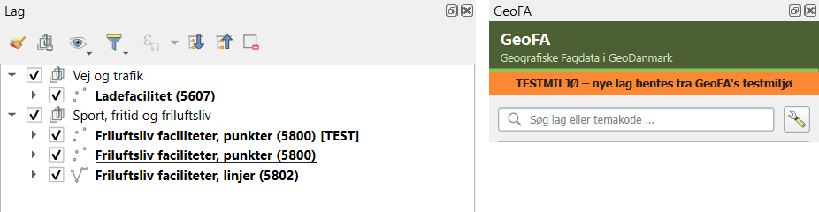

# Vejledning til GeoFA-pluginet i QGIS

GeoFA-pluginet giver adgang til alle GeoFA's 80 datasæt i QGIS – med de samme grupper, navne, felter og kodelister som [GeoFA-specifikationen](https://confluence.kds.dk/display/GS/GeoFA-specifikation) og med symboler som i GeoFA's webkort. Alle kan se de offentlige data. Kommuner og andre myndigheder med et GeoFA-login kan også se de objekter, der ikke er offentlige, og redigere deres egne data.

Pluginet virker i QGIS 3.34 og nyere, også QGIS 4. Her er QGIS med GeoFA-panelet til højre og tre GeoFA-lag på kortet:

## Installation

1. Vælg **Plugins › Administrér og installér plugins …** i QGIS.
2. Søg efter **GeoFA**, og vælg det på listen.
3. Klik på **Installér plugin**.

Derefter har QGIS en menu, der hedder **GeoFA**, og et GeoFA-panel. Panelet åbnes og lukkes under **GeoFA › GeoFA-panel**.

Har du brugt en tidligere version af pluginet (0.36 eller ældre), så læs [Projekter fra ældre versioner](#projekter-fra-ældre-versioner).

## Tilføj lag

### GeoFA-panelet

Panelet viser GeoFA's datasæt i specifikationens grupper. Ikonet ved hvert lag viser, om det er punkter, linjer eller flader.

- **Sæt hak** ved et lag for at tilføje det til kortet. Laget lægges i en gruppe med samme navn som i specifikationen.
- **Fjern hakket** for at fjerne laget fra projektet igen. Et lag, du er i gang med at redigere, fjernes ikke.
- **Sæt hak ved en gruppe** for at tilføje alle dens lag. Ved fire lag eller flere spørger pluginet først.
- **Søg** efter et lag med dets navn, temakode (fx *5800*) eller gruppe.
- **Højreklik** på et lag for at åbne dets side i GeoFA-specifikationen.

Hakkerne følger projektet: fjerner du et GeoFA-lag i lagpanelet, forsvinder hakket også i GeoFA-panelet. Ved hver gruppe står, hvor mange lag den har, og hvor mange der er indlæst.

### Menuen GeoFA

Menuen **GeoFA** har de samme grupper og lag som panelet; klik på et lag for at tilføje det. Nederst i menuen findes:

- **GeoFA-panel** – viser eller skjuler panelet.
- **Indstillinger …** – login, testmiljø og område (se nedenfor).
- **Opdater formularer og kodelister** – se [Projekter fra ældre versioner](#projekter-fra-ældre-versioner).
- **Vejledning** – åbner denne vejledning.
- **Om pluginet …** – version og links.

### QGIS' søgefelt

GeoFA-lag kan også findes i QGIS' søgefelt nederst til venstre (Ctrl+K). Skriv fx `skoledistrikter` eller `5800`, og klik på resultatet for at tilføje laget. Skriver du `geofa` foran, fx `geofa distrikt`, søges der kun i GeoFA's lag:

## Felter og formularer

Når du åbner et objekt (fx med **Identificér objekter**), vises felterne i faneblade:

- **Generelt** – de felter, som alle GeoFA-datasæt har.
- **Datasættets eget faneblad** – fx *Friluftsliv faciliteter, punkter*.
- **Fotos** eller **Fotos og GPX** – kun for datasæt med fotos (se nedenfor).
- **Øvrige felter** – resten, fx tekstudgaver af koderne og systemfelter.

Hvert felt har sit navn fra specifikationen med feltnavnet i parentes, fx *Facilitettype (facil_ty_k)*:

**Kodelister.** Felter med en kodeliste vises som rullelister. Værdierne hentes direkte fra GeoFA, når et lag tilføjes, eller et projekt åbnes, så de altid er de aktuelle. Øverst i hver liste står *&lt;ingen værdi&gt;*. Felter, som GeoFA kræver udfyldt, er markeret med gult, indtil der er valgt en værdi; GeoFA tager ikke imod dem tomme. Når du vælger en kode, udfylder GeoFA selv den tilhørende tekst (fx *oprindelse* ud fra *oprindkode*), når objektet gemmes.

Kan en kodeliste ikke hentes fra GeoFA, får du besked om hvilken, og feltet viser koderne i stedet for teksterne. Du får kun besked én gang pr. kodeliste.

**Lange beskrivelser** (fx *lang_beskr*) kan indeholde formatering. Den vises, når du ser på et objekt; når du redigerer, ser du teksten med formateringskoderne.

## Fotos og GPX-spor

For de datasæt, hvor GeoFA har fotos (fx friluftsfaciliteter og ladefaciliteter), har formularen et faneblad med fotos og eventuelt GPX-spor. Klik på et link for at åbne fotoet eller sporet i din browser. Fanebladet viser kun de fotos og spor, objektet har, og vises kun for objekter, der har mindst ét.

Fotos og GPX-spor vises kun, når du ikke bruger dit login.

## Kun objekter i én kommune

Under **GeoFA › Indstillinger … › Område** kan du vælge en kommune ved **Kun objekter i**. Så viser alle GeoFA-lag i projektet – også dem, der allerede er tilføjet – kun objekter i den kommune og tæt på dens grænse. Panelet viser filteret; klik på det for at ændre det. Vælg *Hele landet* for at se alle objekter igen.

Med en kommune valgt henter et lag alle kommunens objekter på én gang i stedet for kun dem i kortudsnittet, så det går hurtigt at flytte rundt i kortet bagefter.

## Login, flere objekter og redigering

Uden login viser lagene de objekter, der er offentlige, og de kan ikke redigeres. Hvert objekt i GeoFA er markeret med, hvem der må se det: alle, alle myndigheder eller kun den ansvarlige myndighed. Nogle datasæt, fx beskyttelsesrum, har derfor ingen offentlige objekter.

Med et GeoFA-login (kommuner og andre myndigheder) ser du også de objekter, der ikke er offentlige, som dit login giver adgang til, og du kan redigere dine egne data.

### Indtast dit login

1. Vælg **GeoFA › Indstillinger …** (eller **Indstillinger › Indstillinger … › GeoFA** i QGIS).
2. Skriv dit **brugernavn** og din **adgangskode**. Klik på øjet for at se adgangskoden, mens du skriver.
3. Sæt hak i **Brug mit login**, og klik på **OK**.

Adgangskoden gemmes i QGIS' adgangskodelager under navnet *GeoFA* – ikke i projekter eller indstillinger. Derfor kan du trygt dele et projekt; den, der åbner det, skal bruge sit eget login. QGIS kan bede om din hovedadgangskode (master password), når loginet gemmes eller bruges.

### Skift mellem med og uden login

Når et login er gemt, har GeoFA-panelet en knap med et personikon ved søgefeltet. Er den trykket ned, bruger lagene dit login; klik på den for at skifte. Hold musen over knappen for at se, hvad der gælder lige nu. Du kan også skifte under **GeoFA › Brug mit GeoFA-login**.

Lag, du er i gang med at redigere, skifter ikke – gem eller fortryd først.

### Rediger

Brug QGIS' almindelige redigering: vælg laget, klik på **Slå redigering til** (blyanten), ret eller tilføj objekter, og gem. Ændringerne sendes til GeoFA, når du gemmer. Nye objekter får automatisk dit bruger-id og din myndighed. GeoFA afviser at gemme et objekt, hvor et påkrævet felt er tomt, eller hvor en kode ikke findes i kodelisten.

### Fjern dit login

Slet loginet *GeoFA* under **Indstillinger › Indstillinger … › Godkendelse**. Pluginet skifter med det samme til kun at vise offentlige objekter.

### Få et login

Hvis du mangler dit login eller skal oprettes som ny bruger, så send en mail til [support@geopartner.dk](mailto:support@geopartner.dk) med emnet *GeoFA brugeroplysninger*.

## Testmiljøet

Sæt hak i **Testmiljø** under **GeoFA › Indstillinger …** for at hente lag fra GeoFA's testmiljø, fx for at prøve redigering af uden at ændre de rigtige data.

- Lag fra testmiljøet får **[TEST]** i navnet, menuen hedder *GeoFA — TESTMILJØ*, og panelet viser en orange stribe.
- Lag fra produktion bliver i projektet, men kan kun vises, så længe testmiljøet er valgt.
- Kodelisterne for testlagene hentes fra testmiljøet.

Her er det samme lag tilføjet fra både testmiljøet og produktion:

## Projekter fra ældre versioner

Når du åbner et projekt med GeoFA-lag fra en tidligere version af pluginet, tilbyder pluginet at opdatere dem: klik på **Opdater** i beskeden øverst i kortet, eller vælg **GeoFA › Opdater formularer og kodelister**. Lagene får så de nye formularer, og kodelisterne hentes på ny; deres symboler, etiketter og filtre bliver, som de er. Domænetabellerne, som version 0.36 lagde ind i projektet, er ikke længere i brug og fjernes.

Lag, der blev tilføjet med login i version 0.36, har adgangskoden stående i projektfilen. Når dit login er gemt i QGIS (se [Indtast dit login](#indtast-dit-login)), erstatter pluginet adgangskoden med det gemte login. Gem projektet bagefter, så adgangskoden også forsvinder fra filen.

## Mere om GeoFA

- [GeoFA hos GeoDanmark](https://www.geodanmark.dk/home/vejledninger/geofa/) – vejledninger og nyheder
- [GeoFA-specifikationen](https://confluence.kds.dk/display/GS/GeoFA-specifikation) – datasæt, felter og kodelister
- [Pluginet på GitHub](https://github.com/GeoDanmarkGeoFA/QGIS_Plugin_GeoFA) – fejl og ønsker kan meldes under *Issues*
